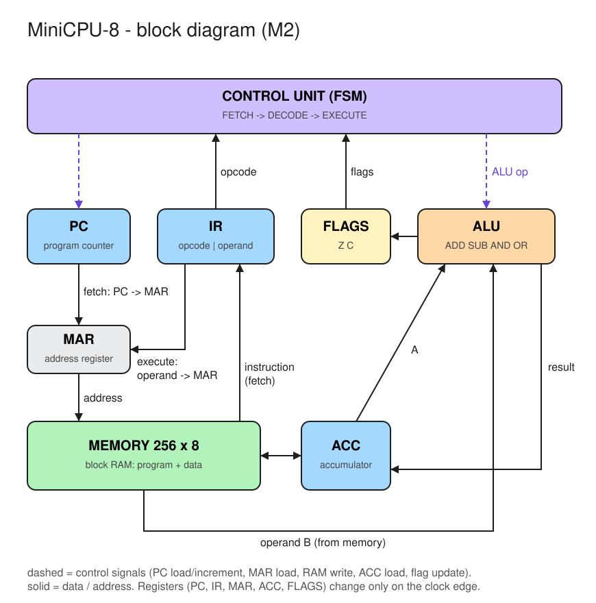

# FPGA_CPU – the journey is the goal

Ich lerne FPGA-Design mit VHDL und baue Schritt für Schritt eine komplette CPU – vom blinkenden LED bis zu Linux auf einem selbst gebauten SoC. Ziel ist tiefes Verständnis, nicht das Endergebnis.

## Die CPU (M2: MiniCPU-8)



## Hardware

- **Board:** iCESugar-Pro (Muse Lab)
- **FPGA:** Lattice ECP5 LFE5U-25F-6BG256C (~24k LUTs)
- **Onboard:** 32 MB SDRAM, microSD, iCELink (JTAG + USB-UART)

## Toolchain (alles Open Source)

[OSS CAD Suite](https://github.com/YosysHQ/oss-cad-suite-build) mit:

- GHDL – Simulation, GTKWave – Wellenformen
- Yosys (mit GHDL-Plugin) – Synthese
- nextpnr-ecp5 – Place & Route
- ecppack (Project Trellis) – Bitstream
- iCELink (Onboard-Debugger) – Programmieren per Drag-and-drop auf das USB-Laufwerk

## Projektstruktur

| Pfad | Inhalt |
|---|---|
| `src/` | synthetisierbares VHDL (Top-Level: `top.vhd`) |
| `sim/` | Testbenches (werden nie synthetisiert) |
| `constraints/` | Pin-Constraints (`.lpf`), nur aus dem [offiziellen Board-Repo](https://github.com/wuxx/icesugar-pro) |
| `build.sh` | gesamter Flow in einem Skript |
| `JOURNAL.md` | Lerntagebuch: was ich machte, was überraschte, was ich nicht verstehe |
| `PROJECT.md` | Status, Arbeitsregeln, Roadmap und Projektnotizen |

## Benutzung

### Einmal pro Terminal: Toolchain aktivieren

```bash
source ~/Desktop/EEProjekt/oss-cad-suite/environment
```

(Pfad dort, wo die [OSS CAD Suite](https://github.com/YosysHQ/oss-cad-suite-build/releases) entpackt wurde.)

### Simulation

```bash
./build.sh sim <testbench>   # GHDL-Simulation -> build/<tb>.vcd
gtkwave build/<tb>.vcd
```

### Bauen und aufs Board laden

```bash
cd ~/Desktop/EEProjekt/FPGA_CPU/fpga-journey
./build.sh all               # synth + pnr + bit  ->  build/top.bit
./build.sh prog              # kopiert build/top.bit auf das iCELink-Laufwerk
```

`prog` ist dasselbe wie von Hand:

```bash
cp build/top.bit /media/$USER/iCELink/ && sync
```

Danach ein paar Sekunden warten – der iCELink programmiert das FPGA selbst. Voraussetzung: Board per USB angesteckt und das Laufwerk „iCELink“ ist eingehängt.

`./build.sh clean` löscht `build/`.

Hinweis: `openFPGALoader` kennt das Board nicht (`-b icesugar_pro` gibt es nicht) und fand den Debugger nicht – deshalb Drag-and-drop.

Grundregel: **Simulation first** – nichts aufs FPGA, was ich nicht in GTKWave gesehen habe.

## Roadmap

| | Meilenstein |
|---|---|
| M0 | Bring-up: Blinky + UART „Hello" |
| M1 | UART TX/RX in Simulation, dann Hardware |
| M2 | MiniCPU-8: 8-Bit-CPU im Ben-Eater-Stil |
| M3 | Assembler in Python |
| M4 | Eigener RV32I-Kern, Interrupts + Timer, FreeRTOS |
| M5 | SoC: Wishbone, UART, Timer, GPIO, SPI, SDRAM, SD-Karte |
| M6 | Linux über LiteX + VexRiscv |
| M7 | Eigenes PCB (handlötbar, iCE40) |
| M8 | Mini-Laptop mit eigenem SoC |
| S1 | Side-Quest: Musik-DSP (DDS, Distortion, Delay, I2S) |

## Status

Board bestellt (01.10.2026), Lieferung ca. Mitte Oktober. Bis dahin: Simulation und Theorie.
